# Homework1
```java
public class Homework1 {
    public static void main(String[] args) {
        int size = 10; 

      
        System.out.println("");
        for (int i = 1; i <= size; i++) {
            for (int j = 1; j <= i; j++) {
                System.out.print("#");
            }
            System.out.println();
        }

        
        System.out.println("\n");
        for (int i = size; i >= 1; i--) {
            for (int j = 1; j <= i; j++) {
                System.out.print("#");
            }
            System.out.println();
        }

       
        System.out.println("\n");
        for (int i = 1; i <= size; i++) {
           
            for (int j = 1; j <= size - i; j++) {
                System.out.print(" ");
            }
            
            for (int k = 1; k <= i; k++) {
                System.out.print("#");
            }
            System.out.println();
        }

        
        System.out.println("\n");
        for (int i = size; i >= 1; i--) {
            
            for (int j = 1; j <= size - i; j++) {
                System.out.print(" ");
            }
           
            for (int k = 1; k <= i; k++) {
                System.out.print("#");
            }
            System.out.println();
        }
    }
}
```
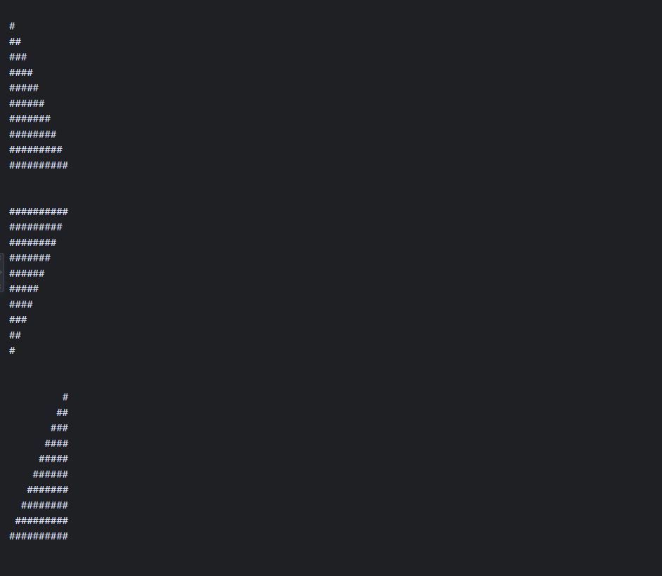


# Homework2
```java
public class Homework2 {
    public static void main(String[] args) {
        int n = 20;
        long[] fib = new long[n];

        fib[0] = 1;
        fib[1] = 1;

        for (int i = 2; i<n;i++){
            fib[i] = fib[i-1]+fib[i-2];
        }

        System.out.println("");
        for(int i=0;i<n;i++){
            System.out.print(fib[i]+(i==n-1?"":","));
        }
        System.out.println();
    }
}


```
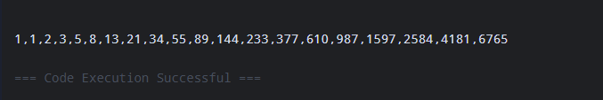

# Homework3
```java
public class Homework3 {
    public static void main(String[] args) {
        int n = 21; 
        long[] fib = new long[n + 1];
        
        fib[1] = 1;
        fib[2] = 1;
        
        for (int i = 3; i <= n; i++) {
            fib[i] = fib[i - 1] + fib[i - 2];
        }
        
        for (int i = 1; i <= 20; i++) {
            double ratio = (double) fib[i + 1] / fib[i];
            System.out.printf("%2d | %d / %d \t\t\t| %.15f%n", i, fib[i + 1], fib[i], ratio);
        }
    }
}

```
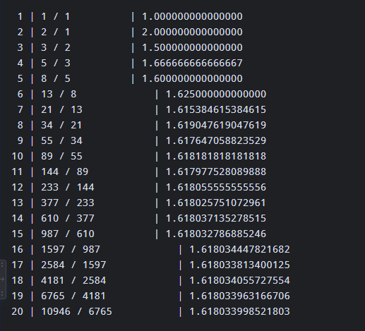


# Homework4
```java
public class Homework4 {
	public static void main(String[] args) {

		
		for(int i=1; i < 10; i++) {
			System.out.println(i + "단을 출력 합니다.");
            
  	         	
			for(int j=1; j < 10; j++) {
				System.out.println(i + " x " + j + " = " + i * j);
			}
			System.out.println();
		}	
	}
}

```
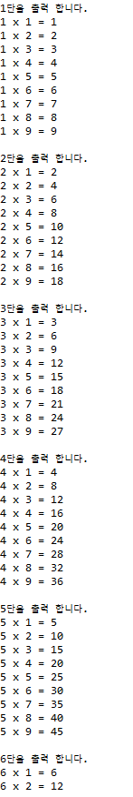

# Homework5
```java
public class homework5 {

    public static double calculatePiGregory(int iterations) {
        double pi = 0.0;
        for (int i = 0; i < iterations; i++) {
            double term = 4.0 / (2 * i + 1);
            
            if (i % 2 == 1) {
                pi -= term;
            } else {
                pi += term;
            }
        }
        return pi;
    }

    
    public static double calculatePiMadhava(int iterations) {
        double sum = 0.0;
        for (int k = 0; k < iterations; k++) {
            
            double term = Math.pow(-1.0 / 3.0, k) / (2 * k + 1);
            sum += term;
        }
        
        return Math.sqrt(12.0) * sum;
    }

    public static void main(String[] args) {
        System.out.println("=== 실제 정밀한 Math.PI 값 ===");
        System.out.println("Java Math.PI : " + Math.PI);
        System.out.println();

        System.out.println("=== 1. 그레고리-라이프니츠 급수 ===");       
        System.out.println("반복 10,000회  : " + calculatePiGregory(10000));
        System.out.println("반복 100,000회 : " + calculatePiGregory(100000));
        System.out.println();

        System.out.println("=== 2. 마다바 급수 ===");
        System.out.println("반복 10회      : " + calculatePiMadhava(10));
        System.out.println("반복 20회      : " + calculatePiMadhava(20));
    }
}

```
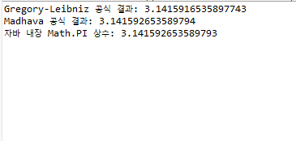

# Homework6
```java
public class homework6 {
    public static void main(String[] args) {
        int n = 7; 
        
        int[][] binomial = new int[n][];
        
        for (int i = 0; i < n; i++) {
            binomial[i] = new int[i + 1];
            
            for (int j = 0; j <= i; j++) {
                if (j == 0 || j == i) {
                    binomial[i][j] = 1;
                } else {
                    binomial[i][j] = binomial[i - 1][j - 1] + binomial[i - 1][j];
                }
            }
        }
        
        for (int i = 0; i < n; i++) {
            for (int j = 0; j <= i; j++) {
                System.out.print(binomial[i][j] + " ");
            }
            System.out.println(); 
        }
    }
}

```
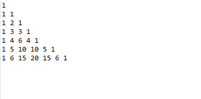

# Homework7
```java
public class homework7 {
    public static void main(String[] args) {
        int data[] = new int[20];
        
        for (int i = 0; i < 20; i++) {
            data[i] = (int)(Math.random() * 100);
        }
        
        System.out.println("--- 정렬 전 ---");
        for (int i = 0; i < 20; i++) {
            System.out.print(data[i] + " ");
        }
        System.out.println("\n");

        for (int i = 0; i < 20 - 1; i++) {
            int minIndex = i; 
            
            for (int j = i + 1; j < 20; j++) {
                if (data[j] < data[minIndex]) {
                    minIndex = j;
                }
            }
            
            int temp = data[minIndex];
            data[minIndex] = data[i];
            data[i] = temp;
        }
        
        System.out.println("--- 정렬 후 (선택 정렬 완료) ---");
        for (int i = 0; i < 20; i++) {
            System.out.println(data[i]);
        }
    }
}


```
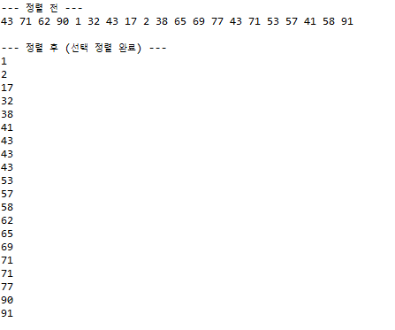

# Homework8
```java
public class homework8 {
    public static void main(String[] args) {
        int[][] score = new int[30][4];
        
        for (int i = 0; i < score.length; i++) {
            for (int j = 0; j < score[i].length; j++) {
                score[i][j] = (int) (Math.random() * 101);
            }
        }

        for (int i = 0; i < score.length; i++) {
            System.out.print((i + 1) + " ");
            
            int sum = 0; 
            
            for (int j = 0; j < score[i].length; j++) {
                System.out.print(score[i][j] + " ");
                sum += score[i][j];
            }
            
            System.out.println(sum);
        }
    }
}


```
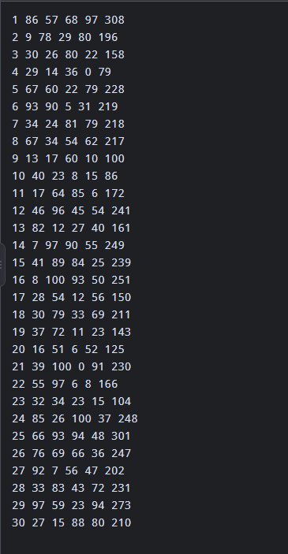

# Homework10
```java
public class homework10 {
    public static void main(String[] args) {
        int arrayCount = 100;
        int maxValue = 100;
        int binSize = 10;
        int displayScale = 1;

        if (args.length >= 4) {
            arrayCount = Integer.parseInt(args[0]);
            maxValue = Integer.parseInt(args[1]);
            binSize = Integer.parseInt(args[2]);
            displayScale = Integer.parseInt(args[3]);
        } else {
            System.out.println("⚠️ 실행 매개변수가 부족하여 기본값(100 100 10 1)으로 실행합니다.");
        }

        int[] data = new int[arrayCount];
        for (int i = 0; i < data.length; i++) {
            data[i] = (int) (Math.random() * (maxValue + 1));
        }

        int binCount = maxValue / binSize;
        if (maxValue % binSize != 0) {
            binCount++;
        }
        int[] histogram = new int[binCount];

        for (int score : data) {
            if (score >= maxValue) {
                histogram[binCount - 1]++;
            } else {
                int binIndex = score / binSize;
                if (binIndex < binCount) {
                    histogram[binIndex]++;
                }
            }
        }

        System.out.println("--- 도수분포표 결과 ---");
        for (int i = 0; i < binCount; i++) {
            int start = i * binSize;
            int end = start + (binSize - 1);
            
            if (end > maxValue) end = maxValue;

            System.out.printf("%d~%d\t", start, end);

            int sharpCount = histogram[i] / displayScale;
            for (int j = 0; j < sharpCount; j++) {
                System.out.print("#");
            }
            System.out.println(); 
        }
    }
}


```
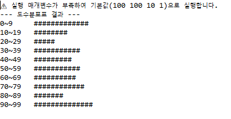


# Homework11
```java
import java.util.Arrays;

public class homework11 {
    public static void main(String[] args) {
        int array_count = 10; 
        int[] arr = new int[array_count];

        System.out.print("Data: ");
        for (int i = 0; i < array_count; i++) {
            arr[i] = (int) (Math.random() * 100) + 1; 
            System.out.print(arr[i] + " ");
        }
        System.out.println("\n");

        double sum = 0;
        for (int i = 0; i < array_count; i++) {
            sum += arr[i];
        }
        double arithmeticMean = sum / array_count;

        double logSum = 0;
        for (int i = 0; i < array_count; i++) {
            logSum += Math.log(arr[i]);
        }
        double geometricMean = Math.exp(logSum / array_count);

        double reciprocalSum = 0;
        for (int i = 0; i < array_count; i++) {
            reciprocalSum += 1.0 / arr[i];
        }
        double harmonicMean = array_count / reciprocalSum;

        Arrays.sort(arr); 
        double median;
        if (array_count % 2 == 0) {
            median = (arr[array_count / 2 - 1] + arr[array_count / 2]) / 2.0;
        } else {
            median = arr[array_count / 2];
        }

        System.out.printf("Arithmetic Mean : %.4f\n", arithmeticMean);
        System.out.printf("Geometric Mean  : %.4f\n", geometricMean);
        System.out.printf("Harmonic Mean   : %.4f\n", harmonicMean);
        System.out.printf("Median          : %.4f\n", median);
    }
}


```
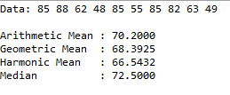


# Homework13
```java
import java.util.Scanner;
import java.util.Stack;

public class homework13 {
    public static void main(String[] args) {
        Scanner scanner = new Scanner(System.in);

        while (true) {
            System.out.print("수식을 입력하세요 (종료하려면 'exit'): ");
            String inputString = scanner.nextLine().trim();

            if (inputString.equalsIgnoreCase("exit")) {
                System.out.println("프로그램을 종료합니다.");
                break;
            }

            String[] arrOfStr = inputString.split("\\s+");
            
            int operandCount = 0;
            for (String token : arrOfStr) {
                if (token.matches("-?\\d+(\\.\\d+)?")) {
                    operandCount++;
                }
            }

            if (operandCount > 3) {
                System.out.println("오류: 피연산자(숫자)는 최대 3개까지만 입력 가능합니다.\n");
                continue;
            }

            try {
                double result = evaluateExpression(arrOfStr);
                System.out.printf("결과: %.2f\n\n", result);
            } catch (Exception e) {
                System.out.println("잘못된 수식입니다. 다시 입력해주세요.\n");
            }
        }
        scanner.close();
    }

    private static int getPriority(String op) {
        switch (op) {
            case "*": 
            case "#": return 2; 
            case "+": 
            case "-": return 1; 
            default: return -1;
        }
    }

    private static double evaluateExpression(String[] tokens) {
        Stack<Double> values = new Stack<>();
        Stack<String> operators = new Stack<>();

        for (String token : tokens) {
            if (token.matches("-?\\d+(\\.\\d+)?")) {
                values.push(Double.parseDouble(token));
            } 
            else if (token.equals("+") || token.equals("-") || token.equals("*") || token.equals("/") || token.equals("#")) {
                while (!operators.isEmpty() && getPriority(operators.peek()) >= getPriority(token)) {
                    values.push(applyOp(operators.pop(), values.pop(), values.pop()));
                }
                operators.push(token);
            }
        }

        while (!operators.isEmpty()) {
            values.push(applyOp(operators.pop(), values.pop(), values.pop()));
        }

        return values.pop();
    }

    private static double applyOp(String op, double b, double a) {
        switch (op) {
            case "+": return a + b;
            case "-": return a - b;
            case "*": 
            case "#": return a * b; 
            case "/": 
                if (b == 0) throw new UnsupportedOperationException();
                return a / b;
        }
        return 0;
    }
}


```
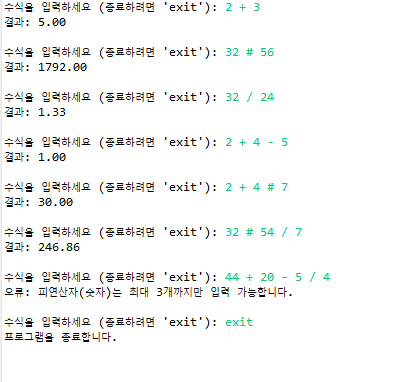


# Homework14
```java
import java.util.Arrays;

class Numbers {
    int num[];

    Numbers(int num[]) {
        this.num = num;
    }

    double getTotal() {
        double sum = 0;
        for (int i = 0; i < num.length; i++) sum += num[i];
        return sum;
    }

    double getArithmeticMean() {
        return getTotal() / num.length;
    }

    double getHarmonicMean() {
        double sum = 0;
        for (int i = 0; i < num.length; i++) {
            if (num[i] != 0) {
                sum += 1.0 / num[i];
            }
        }
        return num.length / sum;
    }

    double getGeometricMean() {
        double sum = 0;
        for (int i = 0; i < num.length; i++) {
            if (num[i] > 0) {
                sum += Math.log(num[i]);
            }
        }
        return Math.exp(sum / num.length);
    }

    int getMedian() {
        sorting();
        int mid = num.length / 2;
        if (num.length % 2 == 1) {
            return num[mid];
        } else {
            return (num[mid - 1] + num[mid]) / 2;
        }
    }

    void sorting() {
        for (int i = 0; i < num.length - 1; i++) {
            for (int j = i + 1; j < num.length; j++) {
                if (num[i] > num[j]) {
                    int temp = num[i];
                    num[i] = num[j];
                    num[j] = temp;
                }
            }
        }
    }

    void drawHistogram(int start, int end, int binCount, int scale) {
        int[] bins = new int[binCount];
        int binSize = (end - start) / binCount;

        for (int i = 0; i < num.length; i++) {
            int index = (num[i] - start) / binSize;
            if (index >= 0 && index < binCount) {
                bins[index]++;
            }
        }

        for (int i = 0; i < binCount; i++) {
            int binStart = start + (i * binSize);
            int binEnd = binStart + binSize - 1;
            System.out.printf("%2d~%2d\t: ", binStart, binEnd);
            
            int sharpCount = bins[i] / scale;
            for (int j = 0; j < sharpCount; j++) {
                System.out.print("#");
            }
            System.out.println();
        }
    }

    void display() {
        System.out.printf("%3d :", num.length);
        for (int i = 0; i < num.length; i++) {
            System.out.printf("%3d ", num[i]);
        }
        System.out.println();
    }
}

public class homework14 {
    public static void main(String[] args) {
        int size = 100;
        int data[] = new int[size];
        for (int i = 0; i < size; i++) {
            data[i] = (int) (Math.random() * 100);
            if (data[i] == 0) data[i] = 1; 
        }

        Numbers obj = new Numbers(data);
        System.out.println("--- 원본 데이터 ---");
        obj.display();

        System.out.println("\n--- 통계 결과 ---");
        System.out.printf("산술평균 : %5.2f\n", obj.getArithmeticMean());
        System.out.printf("기하평균  : %5.2f\n", obj.getGeometricMean());
        System.out.printf("조화평균   : %5.2f\n", obj.getHarmonicMean());
        System.out.printf("중앙값    : %d\n", obj.getMedian());

        System.out.println("\n--- 도수분포표 결과 ---");
  
        obj.drawHistogram(0, 100, 10, 1);
    }
}


```
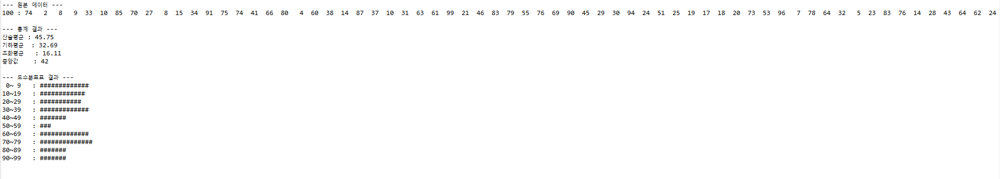

# Homework15
```java
import javax.swing.*;
import java.awt.*;
import java.awt.event.*;
import java.util.ArrayList;
import java.util.Arrays;
import java.util.List;
import java.util.Random;

public class Game2048 extends JPanel {
    private static final int SIZE = 4;
    private static final int BOARD_SIZE = 420;
    private static final int GAP = 12;
    private static final int TILE_SIZE = (BOARD_SIZE - GAP * (SIZE + 1)) / SIZE; // 90px
    private static final int MARGIN_X = 20;
    private static final int BOARD_Y = 125;

    // play2048.co 고유 색상 팔레트
    private static final Color BG_COLOR = new Color(0xFAF8EF);
    private static final Color GRID_COLOR = new Color(0xBBADA0);
    private static final Color EMPTY_TILE_COLOR = new Color(0xCDC1B4);
    private static final Color TEXT_DARK = new Color(0x776E65);
    private static final Color TEXT_LIGHT = new Color(0xF9F6F2);
    private static final Color BTN_COLOR = new Color(0x8F7A66);

    private int[][] board = new int[SIZE][SIZE];
    private int score = 0;
    private int bestScore = 0;
    private boolean won = false;
    private boolean showWinOverlay = false;
    private boolean gameOver = false;

    private final Random random = new Random();
    private final Rectangle newGameBtnRect = new Rectangle(320, 72, 120, 38);
    private final Rectangle overlayPrimaryBtnRect = new Rectangle();
    private final Rectangle overlaySecondaryBtnRect = new Rectangle();

    public Game2048() {
        setPreferredSize(new Dimension(BOARD_SIZE + MARGIN_X * 2, BOARD_Y + BOARD_SIZE + 25));
        setBackground(BG_COLOR);
        setFocusable(true);

        setupKeyBindings();
        setupMouseListener();
        startNewGame();
    }

    private void startNewGame() {
        board = new int[SIZE][SIZE];
        score = 0;
        won = false;
        showWinOverlay = false;
        gameOver = false;

        spawnTile();
        spawnTile();
        repaint();
    }

    // 키보드 방향키 및 WASD 바인딩 (포커스 유실 방지)
    private void setupKeyBindings() {
        InputMap im = getInputMap(WHEN_IN_FOCUSED_WINDOW);
        ActionMap am = getActionMap();

        String[] keys = {"UP", "DOWN", "LEFT", "RIGHT", "W", "S", "A", "D"};
        for (String key : keys) {
            im.put(KeyStroke.getKeyStroke(key), key);
            am.put(key, new AbstractAction() {
                @Override
                public void actionPerformed(ActionEvent e) {
                    if (showWinOverlay || gameOver) return;
                    switch (key) {
                        case "LEFT": case "A": move(0); break;
                        case "DOWN": case "S": move(1); break;
                        case "RIGHT": case "D": move(2); break;
                        case "UP": case "W": move(3); break;
                    }
                }
            });
        }
    }

    // New Game 및 오버레이 버튼 클릭 처리
    private void setupMouseListener() {
        addMouseListener(new MouseAdapter() {
            @Override
            public void mouseClicked(MouseEvent e) {
                Point p = e.getPoint();
                if (newGameBtnRect.contains(p)) {
                    startNewGame();
                    return;
                }
                if (showWinOverlay) {
                    if (overlayPrimaryBtnRect.contains(p)) {
                        showWinOverlay = false; // Keep going
                        repaint();
                    } else if (overlaySecondaryBtnRect.contains(p)) {
                        startNewGame(); // Try again
                    }
                } else if (gameOver) {
                    if (overlayPrimaryBtnRect.contains(p)) {
                        startNewGame(); // Try again
                    }
                }
            }
        });

        addMouseMotionListener(new MouseMotionAdapter() {
            @Override
            public void mouseMoved(MouseEvent e) {
                Point p = e.getPoint();
                boolean hover = newGameBtnRect.contains(p)
                        || (showWinOverlay && (overlayPrimaryBtnRect.contains(p) || overlaySecondaryBtnRect.contains(p)))
                        || (gameOver && overlayPrimaryBtnRect.contains(p));
                setCursor(Cursor.getPredefinedCursor(hover ? Cursor.HAND_CURSOR : Cursor.DEFAULT_CURSOR));
            }
        });
    }

    // 0: Left, 1: Down, 2: Right, 3: Up
    private void move(int rotations) {
        int[][] before = copyBoard(board);

        for (int i = 0; i < rotations; i++) rotateClockwise();
        slideAndMergeLeft();
        for (int i = 0; i < (4 - rotations) % 4; i++) rotateClockwise();

        // 실제로 타일이 이동하거나 합쳐졌을 때만 새 타일 생성 (play2048.co 핵심 규칙)
        if (!Arrays.deepEquals(before, board)) {
            spawnTile();
            if (score > bestScore) {
                bestScore = score;
            }
            if (!canMove()) {
                gameOver = true;
            }
            repaint();
        }
    }

    private void slideAndMergeLeft() {
        for (int r = 0; r < SIZE; r++) {
            int[] compressed = new int[SIZE];
            int idx = 0;
            for (int c = 0; c < SIZE; c++) {
                if (board[r][c] != 0) {
                    compressed[idx++] = board[r][c];
                }
            }

            for (int c = 0; c < SIZE - 1; c++) {
                if (compressed[c] != 0 && compressed[c] == compressed[c + 1]) {
                    compressed[c] *= 2;
                    score += compressed[c];
                    if (compressed[c] == 2048 && !won) {
                        won = true;
                        showWinOverlay = true;
                    }
                    compressed[c + 1] = 0;
                }
            }

            int[] finalRow = new int[SIZE];
            idx = 0;
            for (int c = 0; c < SIZE; c++) {
                if (compressed[c] != 0) {
                    finalRow[idx++] = compressed[c];
                }
            }
            board[r] = finalRow;
        }
    }

    private void rotateClockwise() {
        int[][] rotated = new int[SIZE][SIZE];
        for (int r = 0; r < SIZE; r++) {
            for (int c = 0; c < SIZE; c++) {
                rotated[c][SIZE - 1 - r] = board[r][c];
            }
        }
        board = rotated;
    }

    private void spawnTile() {
        List<Point> emptyCells = new ArrayList<>();
        for (int r = 0; r < SIZE; r++) {
            for (int c = 0; c < SIZE; c++) {
                if (board[r][c] == 0) {
                    emptyCells.add(new Point(r, c));
                }
            }
        }
        if (emptyCells.isEmpty()) return;

        Point p = emptyCells.get(random.nextInt(emptyCells.size()));
        // 원작과 동일하게 90% 확률로 2, 10% 확률로 4 생성
        board[p.x][p.y] = (random.nextInt(10) < 9) ? 2 : 4;
    }

    private boolean canMove() {
        for (int r = 0; r < SIZE; r++) {
            for (int c = 0; c < SIZE; c++) {
                if (board[r][c] == 0) return true;
                if (c < SIZE - 1 && board[r][c] == board[r][c + 1]) return true;
                if (r < SIZE - 1 && board[r][c] == board[r + 1][c]) return true;
            }
        }
        return false;
    }

    private int[][] copyBoard(int[][] src) {
        int[][] dst = new int[SIZE][SIZE];
        for (int i = 0; i < SIZE; i++) {
            dst[i] = Arrays.copyOf(src[i], SIZE);
        }
        return dst;
    }

    @Override
    protected void paintComponent(Graphics g) {
        super.paintComponent(g);
        Graphics2D g2 = (Graphics2D) g;
        g2.setRenderingHint(RenderingHints.KEY_ANTIALIASING, RenderingHints.VALUE_ANTIALIAS_ON);
        g2.setRenderingHint(RenderingHints.KEY_TEXT_ANTIALIASING, RenderingHints.VALUE_TEXT_ANTIALIAS_ON);

        drawHeader(g2);
        drawBoard(g2);

        if (showWinOverlay) {
            drawOverlay(g2, "You win!", new Color(237, 194, 46, 185), TEXT_LIGHT, "Keep going", "Try again");
        } else if (gameOver) {
            drawOverlay(g2, "Game over!", new Color(238, 228, 218, 195), TEXT_DARK, "Try again", null);
        }
    }

    private void drawHeader(Graphics2D g2) {
        // 타이틀 "2048"
        g2.setColor(TEXT_DARK);
        g2.setFont(new Font("SansSerif", Font.BOLD, 54));
        g2.drawString("2048", MARGIN_X, 62);

        // SCORE & BEST 박스
        drawScoreBox(g2, "SCORE", score, 235, 16, 98, 48);
        drawScoreBox(g2, "BEST", bestScore, 342, 16, 98, 48);

        // 안내 문구
        g2.setColor(TEXT_DARK);
        g2.setFont(new Font("SansSerif", Font.PLAIN, 13));
        g2.drawString("Join the tiles, get to 2048!", MARGIN_X, 95);

        // New Game 버튼
        g2.setColor(BTN_COLOR);
        g2.fillRoundRect(newGameBtnRect.x, newGameBtnRect.y, newGameBtnRect.width, newGameBtnRect.height, 8, 8);
        g2.setColor(TEXT_LIGHT);
        g2.setFont(new Font("SansSerif", Font.BOLD, 15));
        drawCenteredText(g2, "New Game", newGameBtnRect);
    }

    private void drawScoreBox(Graphics2D g2, String label, int val, int x, int y, int w, int h) {
        g2.setColor(GRID_COLOR);
        g2.fillRoundRect(x, y, w, h, 8, 8);

        g2.setColor(new Color(0xEEE4DA));
        g2.setFont(new Font("SansSerif", Font.BOLD, 11));
        drawCenteredText(g2, label, new Rectangle(x, y + 4, w, 16));

        g2.setColor(Color.WHITE);
        g2.setFont(new Font("SansSerif", Font.BOLD, 19));
        drawCenteredText(g2, String.valueOf(val), new Rectangle(x, y + 20, w, 24));
    }

    private void drawBoard(Graphics2D g2) {
        g2.setColor(GRID_COLOR);
        g2.fillRoundRect(MARGIN_X, BOARD_Y, BOARD_SIZE, BOARD_SIZE, 12, 12);

        for (int r = 0; r < SIZE; r++) {
            for (int c = 0; c < SIZE; c++) {
                int val = board[r][c];
                int x = MARGIN_X + GAP + c * (TILE_SIZE + GAP);
                int y = BOARD_Y + GAP + r * (TILE_SIZE + GAP);

                g2.setColor(getTileColor(val));
                g2.fillRoundRect(x, y, TILE_SIZE, TILE_SIZE, 8, 8);

                if (val != 0) {
                    g2.setColor(val <= 4 ? TEXT_DARK : TEXT_LIGHT);
                    int fontSize = (val < 100) ? 42 : (val < 1000) ? 34 : 26;
                    g2.setFont(new Font("SansSerif", Font.BOLD, fontSize));
                    drawCenteredText(g2, String.valueOf(val), new Rectangle(x, y, TILE_SIZE, TILE_SIZE));
                }
            }
        }
    }

    private void drawOverlay(Graphics2D g2, String message, Color bg, Color fg, String btn1Text, String btn2Text) {
        g2.setColor(bg);
        g2.fillRoundRect(MARGIN_X, BOARD_Y, BOARD_SIZE, BOARD_SIZE, 12, 12);

        g2.setColor(fg);
        g2.setFont(new Font("SansSerif", Font.BOLD, 48));
        drawCenteredText(g2, message, new Rectangle(MARGIN_X, BOARD_Y + 115, BOARD_SIZE, 60));

        g2.setFont(new Font("SansSerif", Font.BOLD, 15));
        if (btn2Text == null) {
            overlayPrimaryBtnRect.setBounds(MARGIN_X + (BOARD_SIZE - 120) / 2, BOARD_Y + 210, 120, 40);
            g2.setColor(BTN_COLOR);
            g2.fillRoundRect(overlayPrimaryBtnRect.x, overlayPrimaryBtnRect.y, overlayPrimaryBtnRect.width, overlayPrimaryBtnRect.height, 8, 8);
            g2.setColor(TEXT_LIGHT);
            drawCenteredText(g2, btn1Text, overlayPrimaryBtnRect);
        } else {
            int totalW = 120 * 2 + 15;
            int startX = MARGIN_X + (BOARD_SIZE - totalW) / 2;
            overlayPrimaryBtnRect.setBounds(startX, BOARD_Y + 210, 120, 40);
            overlaySecondaryBtnRect.setBounds(startX + 135, BOARD_Y + 210, 120, 40);

            g2.setColor(BTN_COLOR);
            g2.fillRoundRect(overlayPrimaryBtnRect.x, overlayPrimaryBtnRect.y, overlayPrimaryBtnRect.width, overlayPrimaryBtnRect.height, 8, 8);
            g2.fillRoundRect(overlaySecondaryBtnRect.x, overlaySecondaryBtnRect.y, overlaySecondaryBtnRect.width, overlaySecondaryBtnRect.height, 8, 8);

            g2.setColor(TEXT_LIGHT);
            drawCenteredText(g2, btn1Text, overlayPrimaryBtnRect);
            drawCenteredText(g2, btn2Text, overlaySecondaryBtnRect);
        }
    }

    private void drawCenteredText(Graphics2D g2, String text, Rectangle rect) {
        FontMetrics fm = g2.getFontMetrics();
        int x = rect.x + (rect.width - fm.stringWidth(text)) / 2;
        int y = rect.y + ((rect.height - fm.getHeight()) / 2) + fm.getAscent();
        g2.drawString(text, x, y);
    }

    private Color getTileColor(int val) {
        switch (val) {
            case 0:    return EMPTY_TILE_COLOR;
            case 2:    return new Color(0xEEE4DA);
            case 4:    return new Color(0xEDE0C8);
            case 8:    return new Color(0xF2B179);
            case 16:   return new Color(0xF59563);
            case 32:   return new Color(0xF67C5F);
            case 64:   return new Color(0xF65E3B);
            case 128:  return new Color(0xEDCF72);
            case 256:  return new Color(0xEDCC61);
            case 512:  return new Color(0xEDC850);
            case 1024: return new Color(0xEDC53F);
            case 2048: return new Color(0xEDC22E);
            default:   return new Color(0x3C3A32);
        }
    }

    public static void main(String[] args) {
        SwingUtilities.invokeLater(() -> {
            JFrame frame = new JFrame("2048");
            frame.setDefaultCloseOperation(JFrame.EXIT_ON_CLOSE);
            frame.setResizable(false);
            frame.add(new Game2048());
            frame.pack();
            frame.setLocationRelativeTo(null);
            frame.setVisible(true);
        });
    }
}


```
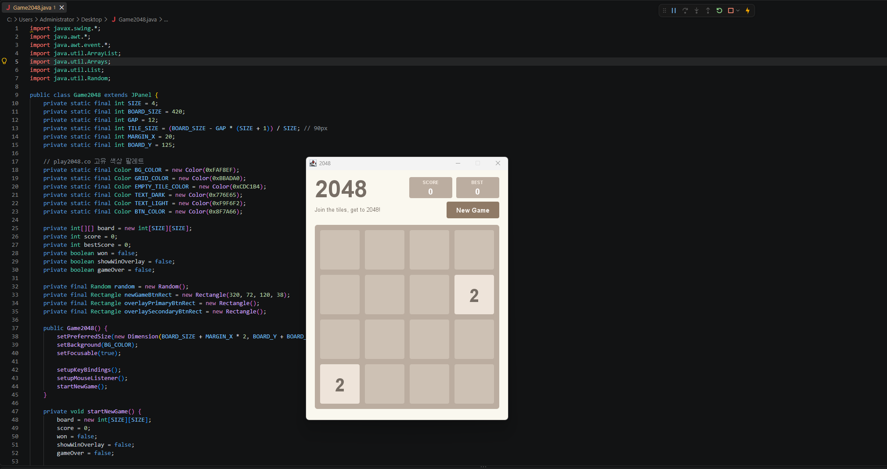
